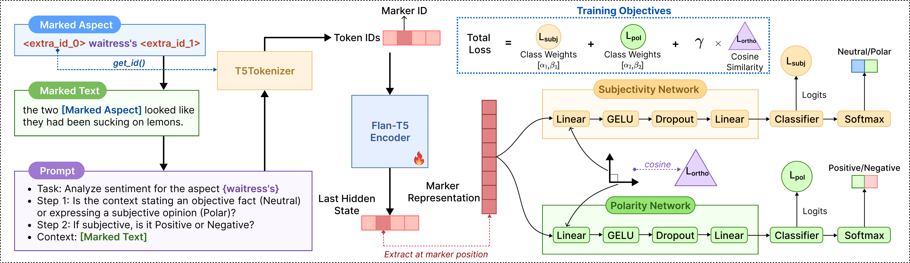

<div align="center">

# Marker–Aligned Subspace Separation for Implicit Sentiment Analysis (MASS)

[-blue?style=flat-square)](./Marker–Aligned_Subspace_Separation_for_Implicit_Sentiment_Analysis.pdf)
[](./Marker–Aligned_Subspace_Separation_for_Implicit_Sentiment_Analysis.pdf)
[](./MASS_run_notebook.ipynb)
[](./requirements.txt)
[](./requirements.txt)
[-ffcc00?style=flat-square)](https://huggingface.co/google/flan-t5-base)
[](./LICENSE)

**Official PyTorch implementation of the SOICT 2026 paper:**  
📄 **[Marker–Aligned Subspace Separation for Implicit Sentiment Analysis](./Marker–Aligned_Subspace_Separation_for_Implicit_Sentiment_Analysis.pdf)**

[Overview](#overview) •
[Repository Structure](#repository-structure) •
[Installation](#installation) •
[Datasets](#datasets) •
[Main Results](#main-results) •
[Usage](#usage) •
[Outputs](#outputs) •
[License](#license)

</div>

---

## Overview

<div align="center">
  
  <br>
  <em><b>Figure 1:</b> The overall architecture of our proposed MASS framework.</em>
</div>

<br>

**MASS** (*Marker-Aligned Subspace Separation*) is a supervised fine-tuning framework for **Aspect-Based Sentiment Analysis (ABSA)** and **Implicit Sentiment Analysis (ISA)** built on the Flan-T5 encoder. Unlike approaches that rely on costly LLM-driven synthetic data augmentation or error-prone multi-hop generation chains, MASS directly addresses two fundamental bottlenecks in implicit sentiment reasoning—*limited focus on the target aspect term* and *frequent confusion at the Neutral–Polar boundary*:

* **Aspect Marker & Structured Two-Step Prompting**: Wraps the target aspect term with sentinel tokens (`<extra_id_0>` and `<extra_id_1>`) inside a structured two-step instruction prompt and extracts the aspect-focused contextual representation at the `<extra_id_0>` marker position solely from the Flan-T5 encoder.
* **Subjectivity–Polarity Subspace Decomposition**: Projects this marker representation into two separate representation subspaces—*Subjectivity* (`Neutral` vs. `Polar`) and *Polarity* (`Positive` vs. `Negative`)—optimized jointly via class-balanced cross-entropy losses and a Frobenius-norm orthogonality regularization penalty, followed by hierarchical inference.

---

## Repository Structure

```text
MASS/
├── Marker–Aligned_Subspace_Separation_for_Implicit_Sentiment_Analysis.pdf
├── figure.png               # Figure 1 architecture diagram (high-resolution PNG)
├── config.yaml              # Full experiment, model, hyperparameter, and ablation configurations
├── main.py                  # CLI entrypoint for training, evaluation, and multi-seed aggregation
├── MASS_run_notebook.ipynb  # Self-contained Google Colab notebook (Flan-T5-Base, Flan-T5-XXL & Ablations)
├── requirements.txt         # Exact Python package versions from Google Colab
├── data/                    # SemEval-2014 Task 4 ABSA datasets with implicit sentiment labels
│   ├── laptops/
│   │   ├── Laptops_Train_v2_Implicit_Labeled.xml
│   │   └── Laptops_Test_Gold_Implicit_Labeled.xml
│   └── restaurants/
│       ├── Restaurants_Train_v2_Implicit_Labeled.xml
│       └── Restaurants_Test_Gold_Implicit_Labeled.xml
└── src/
    ├── config.py            # Configuration schema and YAML resolver
    ├── data.py              # XML parser, prompt builder, and target-centered tokenization dataset
    ├── evaluation.py        # Hierarchical decoding, metrics (Acc. / MF1), and seed aggregation
    ├── labels.py            # Sentiment polarity label mappings
    ├── logging_utils.py     # Timestamped experiment logger
    ├── models.py            # MassModel (Flan-T5 encoder, subspace projections, orthogonality loss)
    └── training.py          # End-to-end training loop and checkpoint management
```

---

## Installation

Install the required dependencies (tested on Google Colab with CUDA 12.8):

```bash
pip install -r requirements.txt
```

---

## Datasets

We evaluate on the **Laptop** and **Restaurant** benchmarks from SemEval-2014 Task 4, extended with boolean `implicit_sentiment` annotations by Li et al. (2021). Following prior work, conflict-labeled instances are removed from both training and test sets.

| Domain | Split | Total | Positive | Negative | Neutral | Implicit (%) |
| :--- | :--- | :---: | :---: | :---: | :---: | :---: |
| | Train | 2,313 | 987 | 866 | 460 | 716 (30.96%) |
| **Laptop** | Test | 638 | 341 | 128 | 169 | 175 (27.43%) |
| | **Total** | **2,951** | **1,328** | **994** | **629** | **891 (30.19%)** |
| | Train | 3,602 | 2,164 | 805 | 633 | 1,030 (28.60%) |
| **Restaurant** | Test | 1,120 | 728 | 196 | 196 | 267 (23.84%) |
| | **Total** | **4,722** | **2,892** | **1,001** | **829** | **1,297 (27.47%)** |

---

## Main Results

Main experimental comparison across `Flan-T5-Base` (250M) and LLM (`8B–11B`) backbones, averaged over 3 random seeds. Within each backbone group, the best score is shown in **bold** and the second-best is <u>underlined</u>.

<table>
  <thead>
    <tr>
      <th rowspan="3" align="left">Method</th>
      <th colspan="4" align="center">Restaurant</th>
      <th colspan="4" align="center">Laptop</th>
    </tr>
    <tr>
      <th colspan="2" align="center">Accuracy</th>
      <th colspan="2" align="center">Macro-F1</th>
      <th colspan="2" align="center">Accuracy</th>
      <th colspan="2" align="center">Macro-F1</th>
    </tr>
    <tr>
      <th align="center">All</th>
      <th align="center">ISA</th>
      <th align="center">All</th>
      <th align="center">ISA</th>
      <th align="center">All</th>
      <th align="center">ISA</th>
      <th align="center">All</th>
      <th align="center">ISA</th>
    </tr>
  </thead>
  <tbody>
    <tr>
      <td>Flan-T5-Base + THOR</td>
      <td align="center">86.16</td>
      <td align="center">64.42</td>
      <td align="center">77.98</td>
      <td align="center">64.69</td>
      <td align="center">80.72</td>
      <td align="center">73.14</td>
      <td align="center">76.70</td>
      <td align="center">69.07</td>
    </tr>
    <tr>
      <td>Flan-T5-Base + Vanilla Inst-FT</td>
      <td align="center">86.52</td>
      <td align="center">64.79</td>
      <td align="center">79.10</td>
      <td align="center">65.31</td>
      <td align="center">81.03</td>
      <td align="center">75.43</td>
      <td align="center">77.39</td>
      <td align="center">71.29</td>
    </tr>
    <tr>
      <td>Flan-T5-Base + RVISA<sub>v</sub></td>
      <td align="center">86.43</td>
      <td align="center">65.92</td>
      <td align="center">78.49</td>
      <td align="center">–</td>
      <td align="center">80.72</td>
      <td align="center">73.71</td>
      <td align="center">76.49</td>
      <td align="center">–</td>
    </tr>
    <tr>
      <td>Flan-T5-Base + MT-ISA<sub>O</sub></td>
      <td align="center">85.89</td>
      <td align="center">66.29</td>
      <td align="center">77.85</td>
      <td align="center">–</td>
      <td align="center">81.98</td>
      <td align="center">75.43</td>
      <td align="center">78.10</td>
      <td align="center">–</td>
    </tr>
    <tr>
      <td>Flan-T5-Base + RVISA<sub>g</sub></td>
      <td align="center">86.61</td>
      <td align="center">66.67</td>
      <td align="center">78.92</td>
      <td align="center">–</td>
      <td align="center">81.19</td>
      <td align="center">75.43</td>
      <td align="center">77.13</td>
      <td align="center">–</td>
    </tr>
    <tr>
      <td>Flan-T5-Base + MT-ISA<sub>I</sub></td>
      <td align="center"><u>88.21</u></td>
      <td align="center"><u>70.41</u></td>
      <td align="center"><u>82.45</u></td>
      <td align="center">–</td>
      <td align="center"><b>82.91</b></td>
      <td align="center"><u>80.57</u></td>
      <td align="center"><u>79.86</u></td>
      <td align="center">–</td>
    </tr>
    <tr>
      <td><b>Flan-T5-Base + MASS (Ours)</b></td>
      <td align="center"><b>88.35</b></td>
      <td align="center"><b>74.87</b></td>
      <td align="center"><b>83.47</b></td>
      <td align="center"><b>73.21</b></td>
      <td align="center"><u>82.19</u></td>
      <td align="center"><b>81.67</b></td>
      <td align="center"><b>80.34</b></td>
      <td align="center"><b>75.08</b></td>
    </tr>
    <tr>
      <td>Llama-3.1-8B-IT + Vanilla Inst-FT</td>
      <td align="center">89.11</td>
      <td align="center">76.78</td>
      <td align="center">82.53</td>
      <td align="center">77.07</td>
      <td align="center">82.60</td>
      <td align="center">77.14</td>
      <td align="center">78.74</td>
      <td align="center">75.17</td>
    </tr>
    <tr>
      <td>Qwen3-8B + Vanilla Inst-FT</td>
      <td align="center">90.62</td>
      <td align="center">77.53</td>
      <td align="center">85.03</td>
      <td align="center">77.15</td>
      <td align="center">83.39</td>
      <td align="center">80.57</td>
      <td align="center">80.12</td>
      <td align="center">77.60</td>
    </tr>
    <tr>
      <td>Flan-T5-XXL + Vanilla Inst-FT</td>
      <td align="center"><u>90.89</u></td>
      <td align="center"><u>80.15</u></td>
      <td align="center"><u>85.68</u></td>
      <td align="center"><u>80.01</u></td>
      <td align="center"><u>85.42</u></td>
      <td align="center"><u>86.29</u></td>
      <td align="center"><u>82.67</u></td>
      <td align="center"><u>84.63</u></td>
    </tr>
    <tr>
      <td><b>Flan-T5-XXL + MASS (Ours)</b></td>
      <td align="center"><b>91.16</b></td>
      <td align="center"><b>82.77</b></td>
      <td align="center"><b>86.27</b></td>
      <td align="center"><b>81.88</b></td>
      <td align="center"><b>85.89</b></td>
      <td align="center"><b>87.43</b></td>
      <td align="center"><b>82.95</b></td>
      <td align="center"><b>85.16</b></td>
    </tr>
  </tbody>
</table>

> **Notation:**
> * `All` = Evaluation on the full test set (both explicit and implicit sentiment instances).
> * `ISA` = Evaluation on the implicit-only test set subset.

---

## Usage

### 1. Run Main Experiments

Train and evaluate **MASS** with `Flan-T5-Base` across all 3 seeds on both datasets:

```bash
python main.py --variant base --dataset restaurants laptops
```

Train and evaluate **MASS** with `Flan-T5-XXL` (`bfloat16` + LoRA):

```bash
python main.py --variant xxl --dataset restaurants laptops
```

Run a single dataset and seed:

```bash
python main.py --variant base --dataset restaurants --seed 42
```

### 2. Run Ablation & Marker-Representation Variants

Run all 6 ablation and marker-representation variants via the `--ablation` CLI argument:

```bash
python main.py \
  --variant base \
  --dataset restaurants laptops \
  --ablation wo_aspect_marker wo_orthogonality wo_two_subspaces wo_class_weights end_marker mean_span_pooling
```

### 3. Preview Resolved Configuration

Inspect the full resolved configuration without starting training:

```bash
python main.py --variant base --dataset restaurants --ablation full --seed 42 --print-config
```

### 4. Interactive Google Colab Notebook

Open [`MASS_run_notebook.ipynb`](./MASS_run_notebook.ipynb) on Google Colab to run **Flan-T5-Base**, **Flan-T5-XXL**, or any **Ablation** variant interactively in a single self-contained notebook.

---

## Outputs

Each run saves its artifacts under `outputs/{dataset}/{variant}/seed_{seed}/` (or `outputs/{dataset}/{variant}/{ablation}/seed_{seed}/` for non-default ablations):

* `checkpoints/best_model.pt` — Model weights from the epoch achieving the highest ISA Macro-F1.
* `results/best_metrics.json` — Best evaluation metrics (`all_accuracy`, `all_macro_f1`, `isa_accuracy`, `isa_macro_f1`) and resolved configuration.
* `results/epoch_metrics.jsonl` — Per-epoch training losses and test metrics.
* `predictions/full_test_predictions.csv` — Instance-level predictions on the full test set (`All`).
* `predictions/isa_test_predictions.csv` — Instance-level predictions on the implicit-only subset (`ISA`).
* `aggregate_metrics.json` — Mean and standard deviation aggregated across all specified seeds.

---

## License

This project is released under the [MIT License](./LICENSE).
